<h1 align="center">OKe</h1>

<p align="center">
  <a href="README.md">English</a> | <b>한국어</b>
</p>

<p align="center">
  
</p>

<p align="center">
  Claude Code 플러그인. 사용자는 orchestrator 한 명과만 대화한다.<br>
  orchestrator 가 저장소마다 PM 을 두고, PM 이 worker 와 reviewer 를 herdr pane 에 띄워 일을 시킨다.<br>
  질문과 승인은 orchestrator 창의 팝업으로 올라온다.
</p>

## 필요한 것

- Claude Code 2.1.322 이상 (mod 를 지원하는 버전)
- herdr 0.9.5 이상 (`herdr agent start / prompt / wait` 가 있어야 한다), 또는 Orca (agent 마다 Orca 터미널 하나; 1.4.261 에서 확인), 또는 둘 다 없으면 `claude --bg` 백그라운드 세션
- Python 3.6 이상 (표준 라이브러리만 쓴다), git

## 설치 (인터넷 되는 곳)

```
claude plugin marketplace add kjoonha/oke
claude plugin install oke@oke
```

업데이트: `claude plugin marketplace update oke` 뒤 `claude plugin update oke@oke`.

## 설치 (인터넷 없는 곳, ftp 반입)

인터넷 되는 곳에서 묶음 하나를 만든다. 설치물은 이 폴더뿐이다 (패키지, daemon, DB 없음). `core.autocrlf=false` 는 Windows 에서 만들어도 줄 끝을 LF 로 둔다.

```
git -c core.autocrlf=false archive --format=tar.gz -o oke.tar.gz HEAD .claude-plugin oke
```

반입한 곳에서 (Linux, tcsh 도 같다):

```
mkdir -p ~/.claude/plugins/marketplaces/oke && tar xzf oke.tar.gz -C ~/.claude/plugins/marketplaces/oke
claude plugin marketplace add ~/.claude/plugins/marketplaces/oke
claude plugin install oke@oke
```

GitHub 으로 받은 marketplace 와 같은 자리다. 플러그인은 이 폴더에서 읽히므로 지우지 않는다 (`claude plugin marketplace remove oke` 가 함께 지운다). 새 버전은 같은 폴더에 다시 풀고 `claude plugin marketplace update oke` 를 부른다.

## 쓰기

herdr pane, Orca 터미널 또는 일반 터미널에서 Claude Code 를 켜고 `/oke:start`. 그 세션이 orchestrator 가 된다. 하고 싶은 일을 말하면 된다. 세션이 끊겼으면 `/oke:resume`.

Orca 에서:

- OKe 는 Orca 의 터미널 탭에서만 돈다. Orca chat 에서는 `/oke:start` 가 거절한다 ("OKe runs in an Orca terminal, not a chat"). chat 에는 mod 화면이 없다.
- Orca 의 Agent Orchestration 설정이 켜져 있어야 하고, Orca 의 새 agent 탭 기본값이 Chat 이 아니라 CLI 여야 한다. OKe 는 PM, worker, reviewer 를 Orca worker 로 새 터미널 탭에서 띄운다 (탭 이름 `OKe PM: <repo>`, `OKe worker 1: <job>` ...). Orca 가 chat 으로 띄우면 OKe 가 뜬 직후 그것을 멈추고 그 기본값을 바꾸라고 알린다 (멈추지 못했으면 Orca 에서 닫을 것을 알려 준다). 첫 PM 을 띄울 때 이것을 만난다.
- agent 는 Orca 가 직접 띄우므로 OKe 의 실행 옵션이 닿지 않는다: OKe 플러그인을 Claude Code 에 설치해야 하고, `lean_launch` 는 효과가 없다.
- agent 터미널을 닫으면 그 agent 에게 다음 메시지가 갈 때 Orca 가 다시 연다. 프로세스가 죽은 agent 는 `gone` 이고, orchestrator 가 다시 띄울지 묻는다 (resume / hold / cancel; autonomy `full` 은 아래 `autonomy`). resume 은 죽은 agent 의 transcript 를 읽는 새 Orca worker 를 띄우고, 그동안 쌓인 메시지도 같이 준다.
- Orca 가 task 를 보냈는데 claude 가 뜨는 것을 못 봤으면 (`start_unknown`), 그 agent 를 읽을 때 화면 대신 안내가 나온다: 다시 띄우거나 (`oke close <handle>`, 그다음 `oke revive <name> --reset`) 기다린다. Orca 가 turn 을 보면 다시 working 이 된다.

`oke status` (와 `oke board`) 는 어느 터미널에서나 된다: orchestrator 가 고른 runtime 을 읽는다. 그 runtime 의 터미널 밖 (예: OKe 가 herdr 나 Orca 에서 도는데 일반 셸) 에서는 보여 주기만 하고 아무것도 띄우지 못한다.

검사: 계획에는 번호 붙은 수용 기준 (`## 수용 기준`) 과 검사 명령 하나 (`## 검증 명령`, 백틱 안) 가 있다. 일을 시작하기 전에 `oke baseline <job>` 이 손대지 않은 checkout 에서 명령을 돌려 원래 깨진 것을 저장한다. worker 는 `oke check <job>` 으로 검사한다: OKe 가 명령을 돌리고, baseline 에 없던 실패 줄만 새 실패로 친다. 결과는 job 장부에 OKe 가 적고, agent 는 이 줄을 적을 수 없다. `oke job merge` 는 리뷰가 계획의 현재 `criteria_rev` (수용 기준과 명령의 해시) 를 적었고, 장부에 리뷰한 커밋에서 통과한 `oke check` 가 있을 때만 합친다. 합친 뒤 `oke job verify <job>` 은 합친 코드가 검사를 통과한 코드와 같으면 돌리지 않고 통과로 적고, 다르면 main 에서 명령을 돌려 새 실패가 있을 때 merge 를 되돌린다.

## 설정: `~/.oke/config.json`

없어도 된다. 있으면 아래 값만 덮어쓴다.

OKe 는 파일을 `~/.oke` 에 둔다. 다른 폴더를 쓰려면 `~/.claude/settings.json` 의 `env` 에 `OKE_HOME` 을 넣는다 (`"env": {"OKE_HOME": "D:/oke"}`). 그러면 Orca 가 띄우는 agent 까지 OKe 의 모든 agent 가 그 값을 받는다. 셸에서만 설정한 변수는 Orca 의 agent 에 닿지 않는다.

```json
{
  "autonomy": "balanced",
  "wiki_path": "~/.oke/wiki",
  "models": {"pm": "opus", "worker": "opus", "reviewer": "opus"},
  "agents": {"worker": "claude", "reviewer": "claude"},
  "interview_threshold": 0.2,
  "interview_max_rounds": 10,
  "lean_launch": true,
  "theme": "disco"
}
```

- `theme`: 대화창 위 띠에 나오는 캐릭터. 역할마다 모양이나 색이 다르다.
  - `disco` (기본): 헤드폰 낀 블롭. orchestrator 보라, PM 파랑, worker 초록, reviewer 주황.
  - `slime`: 통통 뛰는 슬라임. orchestrator 초록, PM 파랑, worker 분홍, reviewer 노랑.
  - `mushroom`: 통통 뛰는 버섯. orchestrator 보라, PM 파랑, worker 주황, reviewer 초록.
  - `cute-dog` (귀가 처진 강아지), `cute-cat` (고양이): 꼬리를 흔들고 귀를 쫑긋하고 눈을 깜빡이며, 잘 때는 몸을 만다. 역할마다 털색이 다르다.
  - disco 색 (orchestrator 보라, PM 파랑, worker 초록, reviewer 주황): `ghost`, `robot`, `frog`, `penguin`, `bunny`, `bear`, `duck`, `octopus`, `alien`, `cactus`, `jellyfish`, `fox`, `panda`, `hamster`, `owl`, `whale`, `dino`, `star`, `pixel-heart`, `coffee`, `onigiri`, `axolotl`, `bee`, `snail`, `chick`, `sakura`.
  - 색 변형: `pastel` (토끼), `candy` (하트), `ocean` (고래), `autumn` (여우), `midnight` (부엉이).
  - 컬러 스킴 (역할 색을 그 스킴의 팔레트에서 가져온다): `tokyo-night`, `catppuccin` (mocha), `github` (dark), `dracula`, `nord`, `gruvbox`, `solarized`, `one-dark`, `monokai`, `rose-pine`, `everforest`, `kanagawa`, `ayu`, `material`, `synthwave-84`.
  - 모르는 이름이면 `disco`.

- `autonomy`: `conservative` (worker 가 명령마다 승인을 묻는다), `balanced` (기본), `full`. `full` 이면 orchestrator 가 계획과 merge 를 묻지 않고 승인하고, 죽은 (`gone`) PM 이나 자식을 한 번은 묻지 않고 다시 띄운다 (`oke revive <name> --auto`); 한 줄로 알려 준다 (PM 은 다시 띄운 자식을 자기 board 에 적는다). 그 뒤 아무 보고 없이 또 죽으면 묻는다 (resume / hold / cancel). hold 한 job 은 다시 띄우지 않는다. `conservative` 와 `balanced` 는 늘 묻는다.
- `lean_launch`: PM / worker / reviewer 를 사용자 plugin, hook, MCP 서버 없이 띄운다 (`--setting-sources project,local --strict-mcp-config`). 사용자 `settings.json` 에서 herdr hook 과 `env` 만 `~/.oke/lean-settings.json` 으로 옮긴다. 시작 context 가 약 76k 에서 40k token 으로 준다. 도구도 역할별 핵심 도구만 켠다 (`--tools`, 시작 context 약 15k token). PM 이 job 마다 assignment header 의 `tools:`, `mcp:`, `plugins:` 로 필요한 것만 더 켠다 (`oke.py extras` 가 목록을 보여준다). 자식에게 개인 설정 전부가 필요하면 `false`.

- `interview_threshold`, `interview_max_rounds`: job 을 받을 때 orchestrator 가 하는 인터뷰. 목표, 제약, 성공 기준을 0~1 로 매겨 모호도(`1 - 0.4 목표 - 0.3 제약 - 0.3 기준`)가 이 값 이하가 될 때까지, 가장 흐린 부분만 한 번에 하나씩 묻는다. 사용자가 "이만 계획" 을 고르거나 최대 횟수에 닿으면 끝난다.

설치 뒤 확인 순서는 `docs/work-checklist.md`.
