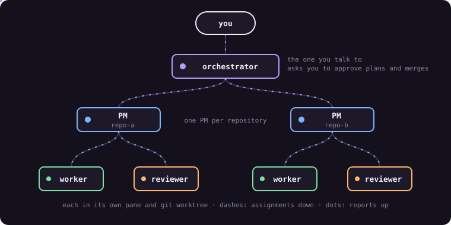

<h1 align="center">OKe</h1>

<p align="center">
  <b>English</b> | <a href="README.ko.md">한국어</a>
</p>

<p align="center">
  <a href="https://github.com/kjoonha/oke/actions/workflows/ci.yml"></a>
  
  <a href="https://github.com/kjoonha/oke/stargazers"></a>
  <a href="https://github.com/kjoonha/oke/commits/main"></a>
  
  
  
</p>

<p align="center">
  
</p>

<p align="center">
  
</p>

<p align="center">
  A Claude Code plugin. You talk to one orchestrator.<br>
  You create named PMs (roles); each PM finds where a job's files are, then runs a worker and a reviewer in their own panes.<br>
  Questions and approvals come back to you as popups in the orchestrator's window.
</p>

## How it is organised

- **Orchestrator**: the Claude Code session you talk to. It asks you about a job (an interview, whatever the job's size) only when your words name nothing concrete (a path, a file, a function, an error text, a command or numbered steps), asks you to approve plans, tells you which branch to merge when a job is done, and keeps the queue.
- **PM**: a named role you create (`backend`, `docs`, ...). A PM is only a name: it owns no folders. The orchestrator gives a job to the PM you named, or to the only PM that has worked on the path you said; otherwise it asks you which PM takes it (every PM plus "New PM"; recommended is the PM that worked on that path). Each job changes one path, a git checkout or a plain folder. The PM finds it while planning, from your words, its wiki and its places (the paths of its earlier jobs), and asks you when none shows it. A PM's session can read the whole file system, so it can look anywhere; it writes only where the guard below allows. Work across several paths becomes several jobs: the PM splits them off and the orchestrator tells you. Each PM keeps its own wiki (`<wiki_path>/<pm>/`). It has a planner subagent draft the plan in the background (a small job's short plan it writes itself), checks it, starts the worker and the reviewer, and delivers only what the review passed.
- **Worker / reviewer**: each runs in its own pane. They write reports. Only the PM delivers, through `oke job deliver`, and only what the review passed; OKe never merges into your branch. A hook blocks git commands that publish or destroy work (`push`, `reset --hard`, forced `clean`, `checkout`, `switch -f` and branch deletes) in every OKe session. Workers, reviewers and a PM's subagents also may not `stash` or throw away the whole tree (`checkout -- .`, `checkout HEAD .`, `restore .`, `rm -r .`); a worker of a job in place and a PM's subagents may not commit (`commit`, `revert`, `merge`, `rebase`, ...): `oke job deliver` does.
- **Where a code job works**: its PM decides and the plan says so, and you see it before approving: in a new worktree (branch `oke/<job>`), in a new worktree whose branch starts from an earlier finished job's branch (`from oke/<job>`), directly in the main checkout, or in a linked worktree you name (it commits on that worktree's branch). Under herdr a worktree sits in `~/.herdr/worktrees/<repository>-<hash of its path>/oke-<job>` and opens as a tab named after the job in its PM's workspace. In place, OKe notes your uncommitted files when the job starts: the job's change is every file that differs from that note, new files included, and only that is committed; your other uncommitted files stay as they are. A file you had changed that the job changes too is asked about before delivery (include your edits, or leave the file out), unless the plan names it on a `Continues: <files>` line under `## Workspace` ("finish what I was doing"). OKe keeps a copy of each of your uncommitted files (up to 2 MB each, 100 MB in all); `oke job restore-user <job> <file>` puts one back as it was. Files the check command makes or changes (logs, outputs) are left by the check: never the job's, never committed. A git repository the job makes inside the checkout is never the job's: OKe refuses to check or deliver until it is moved out. Commits made in the checkout while the job works stop the delivery until you say whose they are. A job with no note of your files commits only the files you name. A second job that changes the same checkout in place waits until the first one is delivered, archived or stopped (the board shows `waiting for <job> to finish`). A plan's optional `## Commits` section (`- <message>: <path>, <path>`, one line may be `rest`) splits the delivery into several commits. A plan over 20 KB or with a line over 2,000 characters is refused (`oke job plan <job>`). Before the approval question, the orchestrator shows the plan's main parts in the chat (`oke job brief <job>`: the absolute path first, then the work place, approach, steps, criteria and check command).
- **What a job hands over** (its output, shown as `output` in `oke status`): `code`, a reviewed branch `oke/<job>` brought onto the latest base branch and checked there, for you to merge (`git merge oke/<job>`; when `origin` is on GitHub or a GitHub Enterprise server the orchestrator offers a pull request through `oke job pr <job>`, which checks `gh auth status --hostname <host>`, pushes the branch and runs `gh pr create` against that host); `files`, a plain folder's files changed in place; `result`, an answer or a run's outputs (an experiment: a temporary edit and a run, for example a simulation, in the main checkout, a linked worktree or a new worktree). An experiment commits nothing: `oke check` and the reviewer check its outputs against the plan, and `oke job deliver` reports where they are; a worktree with them stays after the job until you say to remove it (`oke job clean <job>`). A job that turns out to need no change ends with no change once you agree, as finished, not failed.
- **One flow for every request**: a question and a change start the same way. The PM investigates read-only (nothing in the job's path may change before you approve a plan), then either answers you in its report, with no plan, approval, worktree, review or delivery, or plans the change, which you approve, then the worker works, the reviewer reviews and the PM delivers. "Find out why and fix it" goes straight on to the plan. A question the PM must ask you comes as a popup in your language, one at a time: which job (in your own words), what to decide, and what happens with each option, written as what you get (which files, where, committed or not), never as OKe settings. When an OKe rule, not your choice, blocks the work, the orchestrator says so plainly: that is a bug to report to OKe's maintainer.
- **Size**: `oke job triage` guesses a job's size from your words: `small` for a request that starts with `quick:`, `simple:`, `tiny:`, `minor:`, `small:`, `just:` or `only:`, names a typo, a rename or a one-liner (오타, 이름 바꿔, 한 줄, 간단히), or has at most 50 words; `large` for a refactor, a migration, the architecture or the entire codebase (리팩터, 마이그레이션, 구조, 전체), or more than 200 words; else `normal`. The PM decides the size. A small job has no planner (the PM writes its few-line plan), one approval popup, and a work subagent and a review subagent instead of panes.
- **Approval**: the approval popup offers approve, "Approve, and don't ask again for this job", request changes, or discussing it in the PM pane. Text you type there yourself is the change request and goes to the PM at once. "Don't ask again" (`oke job auto <job>`; also when your request says so in plain words, such as "don't ask", "without asking", 묻지 말고 or 확인 없이, after one popup to confirm it) takes that job's plan approvals from then on and the PM questions that have a recommended option without asking, and tells you in one line; a question without a recommended option, a question about your own files or about more review rounds, a dialog, a pull request, a no-change end and anything that deletes work are still asked.
- **Messages**: a message to an agent waits in its inbox (`$OKE_HOME/inbox/<agent>/`) and is typed in as soon as that agent's turn ends, even while its background subagents or tasks still run. A PM busy with one job's review therefore still takes the next job.
- **Checks**: the plan names numbered acceptance criteria (`## Acceptance criteria`) and one check command (`## Check command`, in backticks), or `none (<why>)` when no command can check the change (then no command runs, and `oke job deliver` takes the review's grade of every criterion as the check). The reviewer grades each criterion `VERIFIED`, `PARTIAL` or `MISSING`, with its evidence; any `PARTIAL` or `MISSING` sends the work back, for at most 3 review rounds (`max_review_rounds`); after that, or as soon as a finding comes back, the PM asks you. The approval question says how the job is checked: "checked by: `<command>`" or "checked by review only (no command): <why>". The worker checks its work with `oke check <job>`: OKe runs the command on the job's work, and a pass is a pass. On a failure OKe runs the same command once on the commit the job started from, in a temporary worktree under OKe's home that it removes again (and removes a leftover one on the next check): with your uncommitted files as they were when the job began, links to the checkout's ignored dependency folders (`base_links`) and copies of its small ignored top-level files (`.env`, `local.settings.json`; up to 1 MB each, 20 MB in all). The check command must not install or change dependencies: it would change them in your checkout through the links. Failure lines the base has too, or that name one of your uncommitted files, are reported as `pre_existing` (a warning), unless they name a file the job changed; the others fail the check. When the base cannot run (`could not check the base: <why>`), or every new failure is on the base too but names a file the job changed (`base_has_it`), the PM asks you whether to accept the failing check for this job (`oke job accept-check <job> <tree> --by-user`). In place, commits made in the checkout after the job began stop `oke check` and the delivery until you say you made them (`oke job accept-head <job> --by-user`); if you did not, the PM stops the job and names the commits that appeared. OKe never resets commits. `job auto` never answers either question. Untracked files the check makes are left uncommitted; a tracked file it changes is part of the job's change. An experiment's check is its run: OKe runs it once and records it with its exit code, with no base run, and the reviewer grades the outputs. OKe writes the result into the job's ledger and signs every row with a key (`$OKE_HOME/ledger.key`) no agent may read; a row without a valid signature, typed or copied by hand, does not count. `oke job deliver <job>` delivers only when the review names the plan's current `criteria_rev` (a hash of the criteria and the command) and the ledger has a passing `oke check` on the reviewed commit. When the base branch moved on, it rebases the branch in its worktree: a conflict goes back to the worker; a rebase that keeps the same change (the same `git patch-id`) carries the review to the new commit, and the PM runs `oke check` there before delivering again. A job is done only when its last delivery is the branch's tip. A job in place gets its reviewed changes committed there instead. A worker in a job's own worktree may commit on its branch: delivery keeps those commits and commits what is left.

Agents talk through files under `$OKE_HOME` (default `~/.oke`), so a crash loses no state. After a terminal, Claude Code or the whole app dies, `/oke:start` finds the open jobs and asks, per job, whether to **resume**, **hold** (set it aside, keep its worktree and branch) or **archive** it.

A PM, worker or reviewer may Edit or Write only in its own folder under OKe's home (a PM also in its open jobs' folders there; never the files only OKe writes, such as the ledger), OKe's `tmp/`, its own memory folder, and the paths of its open jobs once their plan is approved (never a job that ended with an answer): a git job's worktree (else its checkout), or a folder job's folder without the git repositories below it and links that lead out of it (`oke path-check`). Folder jobs change files in place, with no backup.

PMs: say "add a PM", "rename PM <x>" or "remove PM <x>". A PM with open or held jobs is removed only after you agree to cancel those jobs (its wiki is set aside as `<name>.removed-<time>`); a PM is renamed only while it has none; its finished jobs carry over to the new name. `oke pm list` shows them from a shell.

## The board

`/oke-board` opens a live board beside the orchestrator (`oke board` prints the same in a shell; `oke board --full` with every job open). At the top, what waits on you: "To do for you: N approvals · N questions", each with its job. Then one card per job under its PM: your words for the job after "You said:" (the first 100 characters; open the card for all of them; in the shell, a last line says when `oke board --full` would show more), where it is now in plain words and for how long (`now: planning · 12 min`; "approves without asking" for a job set so), and what is left. An open card also shows the job's size, the absolute path it works in, its PM, worker and reviewer, their cost and their todos. Under each PM, "Done" lists its last 5 finished jobs (✓ done, ✗ stopped) with their result and the branch to merge (jobs of a PM that is gone: at the end); open one for all your words and its result on a line of its own. OKe reads an archived job once and keeps its line in `$OKE_HOME/recent-index.json`.

```
╭─────────────────────────────────────────────────────────────╮
│ ╭─────────────────────────────────────────────────────────╮ │
│ │ ✦ To do for you: 1 approval · 0 questions               │ │
│ │ ▸ add a CSV export to the report page: approve the plan │ │
│ ╰─────────────────────────────────────────────────────────╯ │
│ ▍backend PM○                                                │
│ ╭─────────────────────────────────────────────────────────╮ │
│ │ add a CSV export to the report page  csv-export  ▸      │ │
│ │ now  awaiting approval  approve the plan                │ │
│ │ left your approval › work › review › delivery           │ │
│ ╰─────────────────────────────────────────────────────────╯ │
│ Done                                                        │
│ ✓ why is the login slow?  login-slow · answered · ...       │
╰─────────────────────────────────────────────────────────────╯
```

## Requirements

- Claude Code 2.1.322 or later (a version with mod support)
- Python 3.6 or later (standard library only) and git
- One place to run the agents:
  - herdr 0.9.5 or later (agents run in herdr panes), or
  - neither: agents run as background `claude --bg` sessions. A background session cannot answer the trust dialog, so open `claude` once in the OKe home (`~/.oke`) and in each git checkout or folder a job works in, and accept it.

## Install (online)

```
claude plugin marketplace add kjoonha/oke
claude plugin install oke@oke
```

Update: `claude plugin marketplace update oke`, then `claude plugin update oke@oke`.

## Install (offline, e.g. an air-gapped cluster)

On a machine with internet, make one bundle. This folder is the whole install (no packages, no daemon, no database). `core.autocrlf=false` keeps LF line endings even when you build it on Windows.

```
git -c core.autocrlf=false archive --format=tar.gz -o oke.tar.gz HEAD .claude-plugin oke
```

On the target machine (Linux; tcsh works too):

```
mkdir -p ~/.claude/plugins/marketplaces/oke && tar xzf oke.tar.gz -C ~/.claude/plugins/marketplaces/oke
claude plugin marketplace add ~/.claude/plugins/marketplaces/oke
claude plugin install oke@oke
```

This is the same place a marketplace from GitHub lives. The plugin is read from this folder, so do not delete it (`claude plugin marketplace remove oke` removes it with the marketplace). For a new version, unpack it into the same folder again and run `claude plugin marketplace update oke`.

## Use

Start Claude Code in a herdr pane or a plain terminal, and run `/oke:start`. That session becomes the orchestrator. Tell it what you want done. If the session was cut off, run `/oke:resume`.

`oke status` prints JSON whose top-level keys are always there (`herdr`, `state_recovered`, `orchestrator_conflict`, `pms`, `jobs`, `orphan_job_dirs`, `kept_worktrees`; empty or null when there is nothing). `oke status` (and `oke board`) work from any terminal: they read the runtime the orchestrator chose. Outside that runtime's terminals (for example a plain shell while OKe runs in herdr) they only report; nothing can be started from there.

Things you can say along the way:

- `hold <job>`: set a job aside. Its agents are closed; its worktree and branch stay.
- `continue <job>`: bring a held job back; the PM restarts what it needs.
- `cancel <job>`: drop it.
- A new request that goes on from an earlier job: the orchestrator offers to continue it (`continue <job> (branch oke/<job>)`). An open job takes the request as new requirements; a finished job whose branch is still there gets a new job whose branch starts from that branch, so merging the new branch brings both.
- Remove a finished job's worktree and branch: `oke job clean <job>` (it asks for `--force` when the branch is not merged or the worktree has uncommitted files).

## Scheduled runs: `/oke:automate`

Run `/oke:automate` in any Claude Code session and say what should run and how often. Claude asks for the prompt, the folder, the schedule, the permission mode and optionally the model, shows the setup, and registers it: with `crontab` on Linux and macOS, with Task Scheduler (folder `OKe`) on Windows. At each scheduled time a background session (`claude --bg`, named `auto-<name>-<MMDD-HHMMSS>`) starts in that folder with the saved prompt; watch it with `claude attach <session>` or list sessions with `claude agents`.

- Schedules (local time): `every 30m`, `every 2h`, `daily 09:00`, `weekdays 09:00`, `weekly mon,thu 09:00`, and `cron <five fields>` outside Windows.
- The folder must be one Claude Code already trusts: a background session cannot answer the trust dialog.
- Nobody answers a scheduled session's dialogs. With the user's default permission mode it waits at its first dialog until someone attaches; a run is skipped while the previous run of the same automation still works or waits.
- The computer must be on at that time; on Windows the user must be logged in (the task also runs on battery). On Linux and macOS a run gets the PATH and locale the shell had when it was registered; on Windows it gets the user's login environment.
- Each automation is a folder `$OKE_HOME/automations/<name>/` (`automation.json`, `prompt.md`, and `run.log` with one line per run, manual ones included). `oke automate list`, `oke automate run <name>` (one run now) and `oke automate remove <name>` work from a shell too.

## Settings: `~/.oke/config.json`

Optional. Only the values you set override the defaults.

OKe keeps its files in `~/.oke`. To use another folder, set `OKE_HOME` in the `env` of `~/.claude/settings.json` (`"env": {"OKE_HOME": "D:/oke"}`): every agent OKe starts gets it there.

```json
{
  "autonomy": "balanced",
  "wiki_path": "~/.oke/wiki",
  "models": {"pm": "opus", "worker": "opus", "reviewer": "opus"},
  "agents": {"worker": "claude", "reviewer": "claude"},
  "interview_threshold": 0.2,
  "interview_max_rounds": 10,
  "lean_launch": true,
  "effort": {"pm": "high", "worker": "medium", "reviewer": "high"},
  "theme": "disco"
}
```

- `theme`: the characters in the band above the prompt. Each role has its own shape or colour.
  - `disco` (default): blobs in headphones. Orchestrator purple, PM blue, worker green, reviewer orange.
  - `slime`: bouncing slimes. Orchestrator green, PM blue, worker pink, reviewer yellow.
  - `mushroom`: bouncing mushrooms. Orchestrator purple, PM blue, worker orange, reviewer green.
  - `cute-dog` (floppy-eared puppy) and `cute-cat` (kitten): tails wag, ears twitch, they blink and curl up to sleep. Each role has its own coat.
  - In the disco colours (orchestrator purple, PM blue, worker green, reviewer orange): `ghost`, `robot`, `frog`, `penguin`, `bunny`, `bear`, `duck`, `octopus`, `alien`, `cactus`, `jellyfish`, `fox`, `panda`, `hamster`, `owl`, `whale`, `dino`, `star`, `pixel-heart`, `coffee`, `onigiri`, `axolotl`, `bee`, `snail`, `chick`, `sakura`.
  - `claude`: square critters with arm nubs and four legs that throw their arms up while working. Orchestrator Claude orange, PM blue, worker green, reviewer cream.
  - Palette variants: `pastel` (bunnies), `candy` (hearts), `ocean` (whales), `autumn` (foxes), `midnight` (owls).
  - Colour schemes, with role colours from the scheme's own palette: `tokyo-night`, `catppuccin` (mocha), `github` (dark), `dracula`, `nord`, `gruvbox`, `solarized`, `one-dark`, `monokai`, `rose-pine`, `everforest`, `kanagawa`, `ayu`, `material`, `synthwave-84`.
  - An unknown name falls back to `disco`.
- `autonomy`: `conservative` (the worker asks before every command), `balanced` (default) or `full`. With `full` the orchestrator approves plans without asking, and a PM or child that died (`gone`) is resumed once without asking (`oke revive <name> --auto`); you are told in one line (a PM notes a resumed child on its board). If it dies again before it reported anything, you are asked (resume, hold or cancel). Held jobs are never resumed. `conservative` and `balanced` always ask.
- `lean_launch`: start PMs, workers and reviewers without your plugins, hooks and MCP servers (`--setting-sources project,local --strict-mcp-config`). Only the herdr hooks, your `PreToolUse` hooks, `permissions.deny` and `env` from your `settings.json` are copied into the agent's `lean-settings.json` (readable only by you; `job archive` deletes it). `permissions.ask` is not copied. This cuts the starting context from about 76k to 40k tokens. Each role also gets only its core tools (`--tools`, about 15k tokens at start). For each job, the PM turns on extra tools with the assignment header's `tools:`, `mcp:` and `plugins:` lines (`oke.py extras` lists them). Set it to `false` if the agents need all your personal settings.
- `models`: the model of each role (`pm`, `worker`, `reviewer`). Default `opus`.
- `allowed_models`: the models an assignment's `model:` line may pick; any other falls back to the role's model from `models`. Default `[]` (any).
- `effort`: the effort level per role (`pm`, `worker`, `reviewer`): `low`, `medium`, `high`, `xhigh` or `max`. With `lean_launch`, a role left out runs at Claude Code's default effort, not at the `effortLevel` of your own settings; without it, children read your settings.
- `compact_min_percent`: when a PM, worker or reviewer has written the report for a task, its mod compacts its context, keeping what its next work needs (its waiting mail; for a PM each of its jobs that is still open and not on hold, the one just reported included; for a worker or reviewer, that the PM may come back on its job) and dropping the finished task's details. It does so only when at least this percentage of the context is used. Default `30`. Turning auto-compact off in Claude Code turns this off too.
- `check_timeout`: minutes one run of a plan's check command may take, its run on the base too. OKe then stops it and everything it started, and the check fails (`"timed_out": true`; on the base: `could not check the base`). Default `30`.
- `base_links`: the checkout's ignored top-level folders linked into the base run's temporary worktree. Default `["node_modules", ".venv", "venv"]`. Never name an output or cache folder: the run there would write into yours.
- `merge_ignore_untracked`: untracked paths in the checkout that never block a delivery, such as another tool's state folder. Default `[".omc/"]`. Python caches never block either.
- `max_review_rounds`: review rounds per job before the PM asks you. Default `3`.
- `interview_threshold`, `interview_max_rounds`: the interview the orchestrator runs when your request names nothing concrete (`oke job triage` says so). It scores the goal, constraints and success criteria from 0 to 1 and asks one question at a time about the vaguest part, until the ambiguity (`1 - 0.4 goal - 0.3 constraints - 0.3 criteria`) is at or below the threshold. It also stops when you pick "plan now" or it reaches the round limit.

After installing, follow the checks in `docs/work-checklist.md`.

## Token use

Each agent's mod adds one line per turn (its subagents' turns included) to `usage.csv` in the agent's folder: time, model, input, output, cache read and cache write tokens. The orchestrator writes `$OKE_HOME/usage.csv`. `python oke/bin/oke.py cost [job]` adds them up per job (archived jobs too), per PM and for the orchestrator.

## Development

```
cd oke/bin && python -m unittest discover -p "test_*.py"   # CLI and runtime tests
claude plugin test oke                                     # mod (band, board, git guard) tests
```
